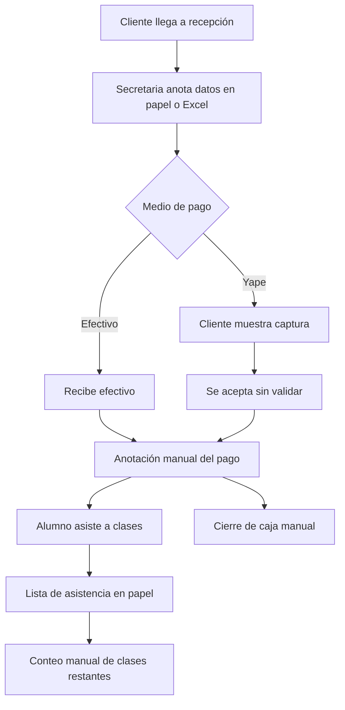
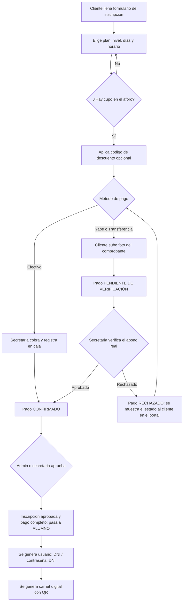
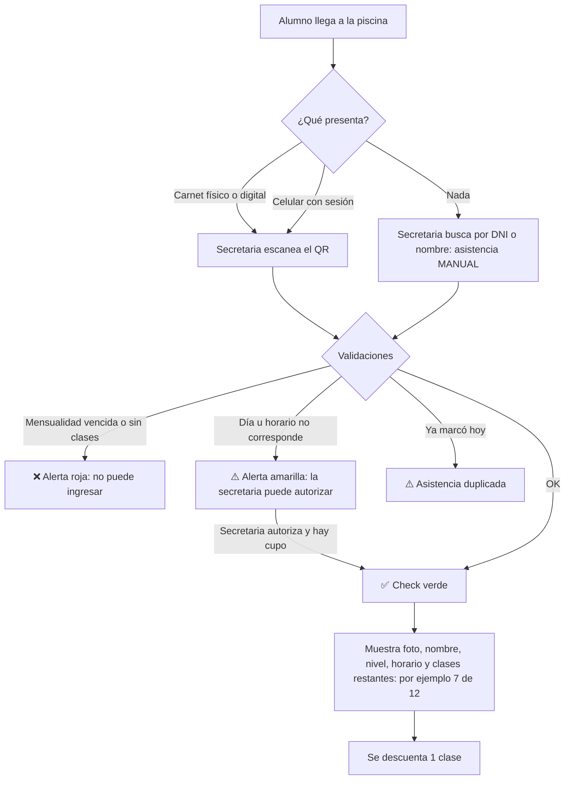
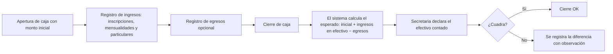
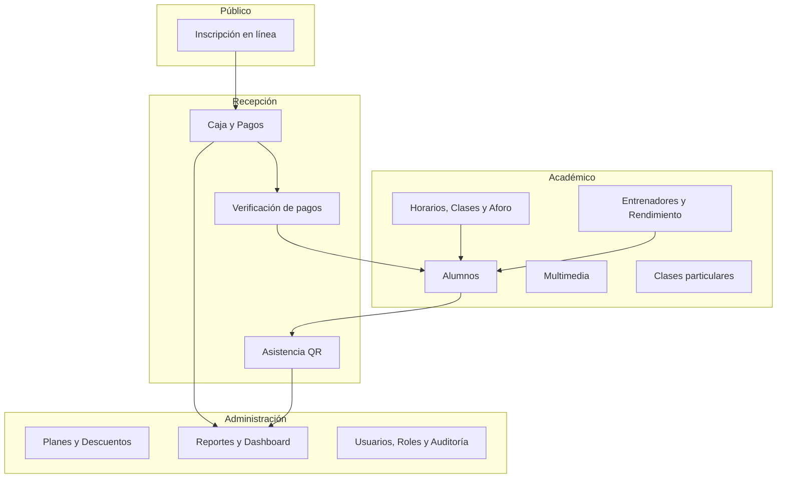
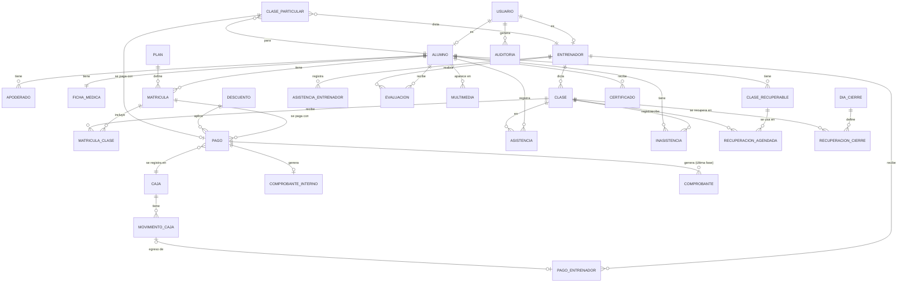

> Decision transversal vigente, 2026-10-20: este software se construira desde cero con sus propios modulos, incluidos usuarios, roles, permisos y auditoria; no dependera de CORE ni copiara modulos de otros productos. La documentacion y metodologia global siguen como referencia. Esta nota sustituye cualquier supuesto anterior de implementacion compartida; no modifica las reglas del negocio de este borrador.

# Documentación del Sistema de Gestión – Academia de Natación

| Campo | Detalle |
|---|---|
| Proyecto | Sistema de Gestión para Academia de Natación |
| Ubicación | Piscina semiolímpica |
| Versión del documento | 2.1 — único celular para toda la operación offline |
| Fecha | 21/10/2026 |
| Estado | Alcance acordado; acceso/dispositivo v0.2.0 implementados; módulos comerciales pendientes |

---

> Acuerdos vigentes: [alcance de primera entrega](01-acuerdos-entregas.md), [operación y sincronización](02-operacion-sincronizacion.md) y [decisión de stack](decisiones/001-stack.md). Las historias de módulos posteriores conservan sus requisitos, pero su prioridad M no las incorpora al MVP. Existe acceso/dispositivo v0.2.0 y diagnóstico técnico; funcionalidades comerciales todavía pendientes. Ver [acceso](07-acceso-dispositivo.md).

## Índice

1. [Descripción de la empresa](#1-descripción-de-la-empresa)
2. [Actores y roles](#2-actores-y-roles)
3. [Flujo de negocio actual](#3-flujo-de-negocio-actual)
4. [Procesos de negocio propuestos](#4-procesos-de-negocio-propuestos)
5. [Reglas de negocio](#5-reglas-de-negocio)
6. [Historias de usuario](#6-historias-de-usuario)
7. [Requerimientos no funcionales](#7-requerimientos-no-funcionales)
8. [Propuesta del sistema](#8-propuesta-del-sistema)
9. [Modelo de datos (preliminar)](#9-modelo-de-datos-preliminar)
10. [Reportes](#10-reportes)
11. [Supuestos, riesgos y preguntas abiertas](#11-supuestos-riesgos-y-preguntas-abiertas)
12. [Plan de implementación por fases](#12-plan-de-implementación-por-fases)
13. [Glosario](#13-glosario)

---

## 1. Descripción de la empresa

La empresa es una **academia de natación** que funciona en una **piscina semiolímpica** (25 m). Ofrece clases grupales por niveles y clases particulares a niños, jóvenes y adultos.

### 1.1 Servicios

| Servicio | Descripción |
|---|---|
| **Clases grupales por plan mensual** | Por ejemplo, el plan de 3 veces por semana: 12 clases al mes de 1 hora cada una. |
| **Niveles** | Básico, Intermedio y Avanzado. |
| **Clases particulares** | Las autoriza el administrador y las cobra la secretaria. |
| **Seguimiento del alumno** | El entrenador registra el rendimiento y sube fotos y videos cada mes. |

### 1.2 Operación

- **Horario de atención:** de 08:00 a 20:00, en bloques de 1 hora (12 bloques al día).
- **Clases en paralelo:** en un mismo bloque pueden darse a la vez clases de nivel básico, intermedio y avanzado, cada una con su propio entrenador.
- **Aforo por clase:** configurable entre **20 y 50** alumnos.
- **Medios de pago:** efectivo, Yape y transferencia bancaria.

### 1.3 Objetivo del sistema

Digitalizar y centralizar estos procesos:
- inscripción
- cobro y control de caja
- asistencia por QR
- control de mensualidades
- seguimiento del rendimiento de los alumnos
- reportes financieros y operativos

El objetivo es reducir errores, evitar fraudes en los pagos y dar visibilidad a la administración.

---

## 2. Actores y roles

| Rol | Descripción | Funciones principales |
|---|---|---|
| **Administrador** | Dueño o gerente de la academia | Configura planes, horarios, aforos y entrenadores. Crea códigos de descuento. Autoriza clases particulares. Ve todos los reportes. |
| **Caja / Secretaria** | Personal de recepción | Inscribe alumnos, cobra, verifica pagos por Yape o transferencia, registra asistencia manual, abre y cierra caja, y modifica horarios de alumnos. |
| **Entrenador** | Profesor de natación | Ve sus horarios y la ficha de sus alumnos, registra su rendimiento, sube fotos y videos mensuales y consulta el historial de pagos que ha recibido. |
| **Alumno** | Persona inscrita con pago verificado | Ingresa con su DNI, ve su carnet digital con QR, su horario, las clases que le quedan, su rendimiento y su multimedia. Cambia su contraseña. |
| **Cliente** (posible alumno) | Interesado que aún no completa la inscripción o cuyo pago no está verificado | Llena el formulario de inscripción, elige plan, días y horario, y paga. |
| **Padre / Apoderado** *(actor secundario)* | Responsable de un alumno menor de edad | Sus datos se registran en el formulario. Ingresa con **la misma cuenta del alumno**. |

### 2.1 Matriz de permisos (resumen)

| Funcionalidad | Admin | Secretaria | Entrenador | Alumno | Cliente |
|---|:-:|:-:|:-:|:-:|:-:|
| Configurar planes, horarios y aforo | ✅ | ❌ | ❌ | ❌ | ❌ |
| Crear códigos de descuento | ✅ | ❌ | ❌ | ❌ | ❌ |
| Autorizar clases particulares | ✅ | ❌ | ❌ | ❌ | ❌ |
| Cobrar clase particular autorizada | ✅ | ✅ | ❌ | ❌ | ❌ |
| Registrar inscripción y cobro | ✅ | ✅ | ❌ | ❌ | ✅ (autoinscripción) |
| Verificar pagos (Yape o transferencia) | ✅ | ✅ | ❌ | ❌ | ❌ |
| Abrir y cerrar caja | ✅ | ✅ | ❌ | ❌ | ❌ |
| Registrar asistencia (QR o manual) | ✅ | ✅ | ❌ | ❌ | ❌ |
| Modificar el horario de un alumno a mitad de mes | ✅ | ✅ | ❌ | ❌ | ❌ |
| Ver la ficha de sus alumnos | ✅ | ✅ | ✅ (solo los suyos) | ❌ | ❌ |
| Editar el rendimiento del alumno | ❌ | ❌ | ✅ | ❌ | ❌ |
| Subir fotos y videos | ✅ | ❌ | ✅ | ❌ | ❌ |
| Ver reportes financieros | ✅ | Parcial (su caja) | ❌ | ❌ | ❌ |
| Ver reportes de asistencia | ✅ | ✅ | Sus clases | Propia | ❌ |
| Ver carnet digital y QR | ✅ | ✅ | ❌ | ✅ | ❌ |
| Autorizar asistencia en otro horario | ✅ | ✅ | ❌ | ❌ | ❌ |
| Registrar pagos a entrenadores | ✅ | ❌ | ❌ | ❌ | ❌ |
| Ver sus pagos recibidos | ❌ | ❌ | ✅ | ❌ | ❌ |
| Registrar días de cierre y fechas de recuperación | ✅ | ❌ | ❌ | ❌ | ❌ |
| Emitir certificados | ✅ | ❌ | ❌ | ❌ | ❌ |
| Ver fotos y videos del alumno | ✅ | ❌ | ✅ (los que sube) | ✅ (solo los suyos) | ❌ |

---

## 3. Flujo de negocio actual

> **Supuesto:** el cliente no describió en detalle cómo opera hoy. Lo siguiente es el escenario típico de una academia sin sistema y debe **validarse con el cliente**.

### 3.1 Descripción

1. El interesado se acerca a recepción y pide información.
2. La secretaria anota los datos en un cuaderno, una ficha física o un Excel.
3. El cliente paga en efectivo o por Yape y muestra la captura en su celular.
4. La secretaria anota el pago a mano. No se valida si el Yape llegó realmente.
5. La asistencia se controla con una lista en papel o de memoria.
6. Las clases restantes del mes se calculan a mano.
7. El cierre de caja se hace contando efectivo, sin cuadrar contra un registro digital.
8. Los entrenadores no tienen un registro formal del progreso de cada alumno.

### 3.2 Diagrama del flujo actual (supuesto)

### 3.3 Problemas detectados

| # | Problema | Impacto |
|---|---|---|
| P1 | Las capturas de Yape no se verifican | Riesgo de fraude por capturas falsas o reutilizadas |
| P2 | Los datos médicos y alergias están en papel | Riesgo de seguridad para el alumno ante una emergencia |
| P3 | La asistencia es manual | Errores, suplantación y discusiones por clases restantes |
| P4 | No hay control de aforo | Clases sobrepobladas |
| P5 | La caja no está cuadrada | Faltantes no detectados |
| P6 | No hay reportes | Decisiones sin datos |
| P7 | No hay seguimiento del rendimiento | Menor valor percibido por padres y alumnos |
| P8 | Los descuentos no están controlados | Pérdida de ingresos |

---

## 4. Procesos de negocio propuestos

### 4.1 Proceso de inscripción y pago

**Detalles clave:**
- Mientras el pago está pendiente, el cupo queda **reservado hasta que la secretaria lo verifique**. Si lo rechaza, el cupo se libera.
- El carnet digital y el QR **solo** se generan con inscripción aprobada y pago completo confirmado.

### 4.2 Proceso de asistencia por QR

### 4.3 Proceso de caja diaria

- Los pagos por **Yape o transferencia** se registran en caja, pero **no** se suman al efectivo físico esperado. Se reportan por separado según el método de pago.

### 4.4 Proceso de clase particular

1. El administrador crea la clase particular: alumno o cliente, entrenador, fecha, hora y precio.
2. El administrador la **autoriza**, y queda disponible para cobro.
3. La secretaria cobra (efectivo o Yape, con el mismo flujo de verificación).
4. Se registra la asistencia de esa sesión.

### 4.5 Proceso de renovación de mensualidad

1. Al acercarse el fin de mes, el sistema marca a los alumnos **por vencer**.
2. El alumno renueva: paga el siguiente mes y puede **elegir de nuevo días y horario** para el nuevo periodo.
3. Si no renueva, al iniciar el mes queda **vencido** y el QR muestra una alerta roja.

### 4.6 Proceso de seguimiento del rendimiento

1. El entrenador entra a su panel y ve sus clases y alumnos.
2. Abre la ficha del alumno: datos generales, datos médicos y alergias (solo lectura).
3. Registra la evaluación de rendimiento del mes.
4. Sube las fotos y videos del mes.
5. El alumno ve su evolución desde su perfil.

---

### 4.7 Registro de inasistencias y avisos en el portal

La nube evalúa las clases y asistencias recibidas, registra inasistencias y las muestra en el portal del alumno. Debe indicar fecha de actualización y permitir regularización tras sincronización tardía; no dar por definitivos datos todavía pendientes en celulares. Las exclusiones por cierres o recuperaciones se incorporan cuando sus módulos estén disponibles.

---

## 5. Reglas de negocio

| Código | Regla |
|---|---|
| **RN-01** | Una persona es Cliente hasta que administración o secretaría apruebe su inscripción y su pago completo esté confirmado. Entonces pasa a Alumno activo; la solicitud online por sí sola no asegura cupo. |
| **RN-02** | El **usuario** del alumno es su **DNI** y la **contraseña inicial** también es su DNI. El sistema **obliga a cambiarla** en el primer ingreso (recomendación de seguridad). |
| **RN-03** | El DNI es único en el sistema. |
| **RN-04** | Efectivo se confirma al cobrar. Yape y transferencias requieren comprobante y verificación humana por personal autorizado; puede realizarse offline según RN-41. El pago debe ser completo. |
| **RN-05** | El **carnet digital con QR** se genera solo con inscripción aprobada y pago completo confirmado. |
| **RN-06** | El QR lo genera el sistema, es único por alumno y es el mismo que se lee en la asistencia. Contiene un identificador seguro, **no datos personales**. |
| **RN-07** | Los **planes son variados y los define el administrador**: nombre, veces por semana, clases por mes, duración de la clase, precio, días y horarios permitidos, niveles a los que aplica y vigencia. Ejemplo de referencia: 3 veces por semana, 12 clases al mes, 1 hora por clase. |
| **RN-08** | Al inscribirse, el alumno **elige días y horario**. Una vez elegidos, **no puede modificarlos hasta fin de mes**. Solo la **secretaria** o el **administrador** puede cambiarlos. |
| **RN-09** | Horario de clases: de **08:00 a 20:00**, en bloques de 1 hora. |
| **RN-10** | En un mismo bloque pueden darse a la vez clases de nivel **Básico, Intermedio y Avanzado**, cada una con **un entrenador asignado**. |
| **RN-11** | El aforo de cada clase es configurable entre 20 y 50 alumnos. Online se controla disponibilidad; offline se permite aprobar y cobrar aunque luego resulte sobrecupo. Al sincronizar se conservan las inscripciones y se informa al administrador para resolverlo con los clientes. Esta excepción se explica en capacitación. |
| **RN-12** | Los **códigos de descuento** solo los crea el **administrador**. Pueden ser porcentaje o monto fijo, con vigencia y límite de usos. |
| **RN-13** | Las **clases particulares** solo pueden cobrarse si el administrador las **generó y autorizó** antes. |
| **RN-14** | Cada asistencia registrada **descuenta una clase** del plan del mes. |
| **RN-15** | No se puede registrar asistencia si la mensualidad está vencida o no quedan clases. |
| **RN-16** | Solo se permite **una asistencia por alumno por día** (salvo clases particulares). |
| **RN-17** | Existen varias cajas: una por persona que cobra, con apertura, movimientos y cierre propios. Se requiere su caja abierta para cobrar; una caja cerrada no admite nuevos movimientos. El administrador consulta todas. Las operaciones offline se consolidan al sincronizar. |
| **RN-18** | El entrenador solo ve y edita el rendimiento de **sus propios alumnos**. |
| **RN-19** | Las fotos y videos se organizan **por mes** y **por alumno**. **Solo los ve la cuenta del alumno**, además del administrador y el entrenador que los subió. No hay galerías por clase ni públicas. |
| **RN-20** | Si el alumno es menor de edad, los **datos del padre o apoderado** son obligatorios. |
| **RN-21** | Los datos médicos y las alergias son visibles para la secretaria, el administrador y el entrenador del alumno, y deben destacarse en la ficha. |
| **RN-22** | Toda operación de caja, verificación de pago o cambio de horario queda registrada en **auditoría**: quién, cuándo y qué. |
| **RN-23** | **Clases no usadas a fin de mes:** por defecto **no son recuperables** y se pierden al cerrar el mes. El **administrador** puede marcarlas como recuperables para un alumno concreto, indicando la cantidad de clases, la fecha límite para usarlas y el motivo. |
| **RN-24** | **Recuperación de clases perdidas:** por defecto **no** se recuperan. El **administrador** puede autorizar una recuperación. La secretaria la agenda en otra clase del **mismo nivel que tenga cupo**, y la asistencia descuenta de las clases recuperables y no del plan del mes. |
| **RN-25** | Inscripción a mitad de mes: importe proporcional = precio del plan con IGV incluido ÷ clases del plan × clases restantes según calendario y días elegidos, con tope igual al plan. Se redondea hacia arriba al sol entero. No se vuelve a sumar IGV. El administrador puede ajustar importe o clases con motivo auditado. |
| **RN-26** | Todo cobro confirmado genera un **comprobante**, y solo cuando el pago está confirmado (en Yape o transferencia, tras la verificación humana). **primera entrega (MVP):** comprobante interno o ticket imprimible con valor de venta, IGV y total. **última fase:** comprobante electrónico SUNAT, **boleta** por defecto o **factura** si el cliente da un RUC. |
| **RN-27** | **No se cobra matrícula** (inscripción única). El cliente solo paga la mensualidad, que puede ser proporcional según la RN-25. |
| **RN-28** | Un pago por Yape o transferencia **pendiente de verificación reserva el cupo sin límite de tiempo**, hasta que la secretaria lo apruebe o lo rechace. Al rechazarse, el cupo se libera. |
| **RN-29** | Los **padres o apoderados** usan **la misma cuenta del alumno**; no hay cuentas separadas para padres. |
| **RN-30** | Un alumno puede asistir a un **horario distinto** al suyo solo si la **secretaria lo autoriza** y hay cupo en esa clase. La clase se descuenta de su plan del mes. |
| **RN-31** | El pago a los entrenadores es **en efectivo y fuera del sistema**. El administrador **registra** cada pago realizado (fecha, periodo, monto y concepto) y el entrenador lo ve en su cuenta como **cancelado**. El sistema no calcula sueldos. |
| **RN-32** | Los **certificados** son opcionales: el administrador decide si emite uno, a quién y con qué motivo (por ejemplo, nivel aprobado). |
| **RN-33** | Cuando la piscina **cierra** (feriado, mantenimiento u otro motivo), las clases afectadas **se recuperan**. El administrador registra el cierre y define las **fechas de recuperación**, y las clases afectadas no se descuentan del plan. |
| **RN-34** | Las inasistencias y avisos se registran para consulta en el portal del alumno. La nube los calcula tras recibir las asistencias sincronizadas y muestra la fecha de actualización; regulariza registros tardíos. No hay mensajería externa. |
| **RN-35** | Cada pago a un entrenador tiene un **origen que decide el administrador**: **desde caja**, que genera un egreso en la caja abierta del día, o **externo**, que sale del bolsillo del administrador y no afecta la caja. |
| **RN-36** | Los precios incluyen IGV. No se añade otro 18 % al cobrar. El comprobante interno desglosa valor de venta, IGV y total. El tratamiento tributario configurable se especificará por funcionalidad; la validación tributaria y SUNAT corresponden a su etapa. |
| **RN-37** | Orden: (1) precio con IGV incluido o proporcional; (2) descuento cuando su módulo esté disponible; (3) redondeo hacia arriba al sol entero si existen céntimos. Para operación afecta al 18 %, valor de venta = total final ÷ 1.18 e IGV = total − valor de venta, a dos decimales. Ejemplo: plan S/ 100, 12 clases, 5 restantes: 100 ÷ 12 × 5 = 41.666…; se cobra S/ 42.00, valor de venta S/ 35.59 e IGV S/ 6.41. Es regla de producto, pendiente de verificación en la spec monetaria. |

| **RN-38** | Solo se aceptan pagos completos; no hay abonos ni saldos de mensualidad. |
| **RN-39** | El alumno actual tiene prioridad para renovar su horario; el administrador toma la decisión final. La implementación concreta de reserva se detallará en la spec de renovación. |
| **RN-40** | Solo un celular Android designado permite toda la operación offline, hasta 24 horas desde su última sincronización exitosa. Los demás requieren conexión para registrar cambios. Al vencer el plazo quedan disponibles las consultas locales, pero se bloquean nuevas operaciones hasta sincronizar. |
| **RN-41** | Efectivo, Yape y transferencias pueden confirmarse manualmente offline por personal autorizado. Debe comprobarse el abono; una captura por sí sola no equivale a verificación. Los cambios se envían después. |
| **RN-42** | Online una persona registra asistencia y varias pueden inscribir/cobrar. Offline todo ocurre en un único celular designado, sin comunicación directa con otros. Un alumno inscrito, aprobado y con pago completo confirmado queda disponible allí para asistencia inmediata. No se requiere regularización por separación entre celulares offline. |
| **RN-43** | En conflicto prevalece la primera operación válida aceptada por la nube; la otra no se aplica al registro operativo y queda completa en auditoría para el administrador. No decide la hora del celular. |
| **RN-44** | El único celular offline conserva una cola persistente de operaciones. Un reintento de la misma operación no debe duplicar pagos, movimientos ni asistencias. Las operaciones diferentes con sobrecupo se conservan según RN-11. |

---

## 6. Historias de usuario

El documento de acuerdos determina qué historias entran en cada entrega. Las funciones futuras que aparecen en flujos completos no se habilitan en el MVP por aparecer aquí.

**Formato:** *Como [rol], quiero [acción], para [beneficio].*
**Prioridad (MoSCoW):** M = Must (debe tener), S = Should (debería tener), C = Could (podría tener).

### Épica 1: Inscripción y alumnos

#### HU-01: Formulario de inscripción
**Como** cliente, **quiero** llenar un formulario de inscripción con mis datos, **para** registrarme en la academia.
**Prioridad:** M
**Criterios de aceptación:**
- El formulario pide los siguientes datos:
  - nombre completo
  - DNI
  - fecha de nacimiento (de la que se calcula la edad)
  - teléfono
  - correo
  - dirección
  - grado de colegio
  - nivel de natación (básico, intermedio o avanzado)
  - plan
- Datos médicos:
  - tipo de sangre
  - enfermedades o condiciones
  - **alergias**
  - medicamentos
  - seguro
  - contacto de emergencia
- Si la persona es menor de edad, se exigen los datos de padre, madre o apoderado: nombre, DNI, teléfono y parentesco.
- Se valida que el DNI tenga 8 dígitos y no esté ya registrado.
- Se debe aceptar el tratamiento de datos personales y el deslinde de responsabilidad.

#### HU-02: Elección de días y horario
**Como** cliente, **quiero** elegir los días y el horario de mis clases según mi nivel, **para** asistir cuando me convenga.
**Prioridad:** M
**Criterios de aceptación:**
- Solo se muestran las clases del nivel del cliente que tienen cupo disponible.
- El número de días elegidos coincide con la frecuencia del plan (por ejemplo, 3 días para el plan de 3 veces por semana).
- Se muestran los cupos restantes de cada clase.
- Si una clase se llena mientras el cliente está eligiendo, el sistema avisa y pide otra opción.

#### HU-03: Bloqueo de cambio de horario
**Como** administrador, **quiero** que el alumno no pueda cambiar sus días ni su horario hasta fin de mes, **para** mantener la organización de las clases.
**Prioridad:** M
**Criterios de aceptación:**
- El alumno no ve la opción de editar su horario en su perfil.
- La secretaria y el administrador sí pueden cambiarlo, indicando un motivo que queda en auditoría.
- El cambio respeta el aforo de la clase destino.

#### HU-04: Conversión de cliente a alumno
**Como** secretaria, **quiero** que el cliente pase a ser alumno al confirmarse su pago, **para** que pueda usar el sistema y asistir a clases.
**Prioridad:** M
**Criterios de aceptación:**
- Al aprobarse la inscripción y confirmarse el pago completo, el estado cambia a «Alumno activo».
- Se crea automáticamente el usuario (DNI) y la contraseña inicial (DNI), con cambio obligatorio, tras aprobación y pago completo.
- Se genera el carnet digital con QR.

#### HU-05: Acceso del alumno y cambio de contraseña
**Como** alumno, **quiero** ingresar con mi DNI y cambiar mi contraseña, **para** proteger mi cuenta.
**Prioridad:** M
**Criterios de aceptación:**
- El primer inicio de sesión usa DNI como usuario y DNI como contraseña.
- En el primer ingreso se pide cambiar la contraseña.
- El alumno puede cambiar su contraseña cuando quiera desde su perfil.
- Existe una opción de «Olvidé mi contraseña»: la secretaria puede restablecerla al DNI.

#### HU-06: Perfil del alumno
**Como** alumno, **quiero** ver en mi perfil mis datos, plan, horario, clases restantes y vencimiento, **para** saber el estado de mi mensualidad.
**Prioridad:** M
**Criterios de aceptación:**
- Se muestran: nombre completo, DNI, nivel, edad, plan, días y horario, clases usadas y restantes (por ejemplo, 5 de 12) y fecha de vencimiento.

### Épica 2: Pagos y verificación

#### HU-07: Pago en efectivo
**Como** secretaria, **quiero** registrar un pago en efectivo, **para** confirmar la inscripción o mensualidad al instante.
**Prioridad:** M
**Criterios de aceptación:**
- Solo se puede cobrar con la caja abierta.
- El pago se registra en la caja del día y se genera un comprobante interno (o ticket) imprimible con valor de venta, IGV y total (RN-26 y RN-37). La boleta o factura electrónica llega en la última fase (HU-37).

#### HU-08: Pago por Yape o transferencia con foto
**Como** cliente, **quiero** subir la foto de mi comprobante de Yape o transferencia, **para** que la academia valide mi pago.
**Prioridad:** M
**Criterios de aceptación:**
- Se acepta una imagen (JPG o PNG, máximo 5 MB) desde la cámara o la galería.
- Se registran el número de operación, el monto y la fecha del comprobante.
- El pago queda en estado «Pendiente de verificación».
- El sistema avisa si el número de operación ya fue usado antes (prevención de duplicados).

#### HU-09: Verificación de pagos
**Como** secretaria, **quiero** ver la bandeja de pagos pendientes y aprobarlos o rechazarlos, **para** confirmar solo los pagos reales.
**Prioridad:** M
**Criterios de aceptación:**
- La bandeja lista los pagos pendientes con la foto ampliable, el monto, el número de operación, el cliente y la fecha.
- Las acciones son **Aprobar** o **Rechazar** (el rechazo exige un motivo).
- Al aprobar el pago y estar aprobada la inscripción, se genera el carnet. Al rechazar, el estado y motivo se muestran en el portal.
- Queda registrado quién verificó y cuándo.

#### HU-10: Códigos de descuento
**Como** administrador, **quiero** crear códigos de descuento, **para** dar promociones controladas.
**Prioridad:** M
**Criterios de aceptación:**
- Cada código tiene:
  - tipo (porcentaje o monto fijo)
  - valor
  - fecha de inicio y fin
  - usos máximos
  - planes a los que aplica
  - estado activo o inactivo
- Solo el administrador puede crear, editar o desactivar códigos.
- El sistema valida el código al momento del pago y muestra el precio final, con el descuento aplicado sobre el precio con IGV incluido, antes del redondeo (RN-37).
- El reporte indica cuántas veces se usó cada código y el monto descontado.

#### HU-11: Control de mensualidades
**Como** secretaria, **quiero** ver el estado de mensualidad de cada alumno, **para** saber quién está al día, por vencer o vencido.
**Prioridad:** M
**Criterios de aceptación:**
- Los estados posibles son: Al día, Por vencer (últimos 5 días, configurable), Vencido y Pendiente de verificación.
- Se puede filtrar por estado, plan, nivel, horario y mes.

#### HU-34: Cobro proporcional por inscripción a mitad de mes
**Como** secretaria, **quiero** que el sistema calcule automáticamente el monto proporcional cuando alguien se inscribe a mitad de mes, **para** cobrar solo las clases que podrá recibir.
**Prioridad:** M
**Criterios de aceptación:**
- El sistema cuenta las clases restantes del mes según los días elegidos, desde la fecha de inicio hasta fin de mes, con un tope igual a las clases del plan.
- Calcula la base: `precio_plan ÷ clases_por_mes × clases_restantes`.
- El código de descuento, si lo hay, se aplica **sobre el monto proporcional**, antes del redondeo, sin volver a sumar IGV.
- No suma IGV nuevamente; **redondea hacia arriba** al sol entero el importe con IGV incluido (RN-37).
- La pantalla de cobro muestra el desglose: base, descuento, valor de venta, IGV y total.
- La matrícula del mes se crea con `clases_totales` igual a las clases restantes (por ejemplo, 5 de 12).
- El **administrador** puede modificar el monto o las clases, con un motivo obligatorio que queda en auditoría.

#### HU-12: Renovación de mensualidad
**Como** alumno, **quiero** renovar mi mensualidad y elegir mi horario para el siguiente mes, **para** continuar mis clases.
**Prioridad:** M
**Criterios de aceptación:**
- La renovación sigue el mismo flujo de pago (efectivo o verificación).
- El alumno actual tiene prioridad para conservar su horario; el administrador toma la decisión final (RN-39).

### Épica 3: Carnet digital y asistencia

#### HU-13: Carnet digital con QR
**Como** alumno, **quiero** tener un carnet digital con mi QR, **para** registrar mi asistencia.
**Prioridad:** M
**Criterios de aceptación:**
- El carnet muestra: foto, nombre, DNI, nivel, plan, horario, vigencia y QR.
- Se puede ver en el celular y descargar o imprimir como PDF para el carnet físico.
- El QR del carnet físico y el del celular es el mismo.

#### HU-14: Registro de asistencia por QR
**Como** secretaria, **quiero** escanear el QR del alumno, **para** registrar su asistencia de forma rápida.
**Prioridad:** M
**Criterios de aceptación:**
- El escaneo se hace con la cámara del celular Android del responsable de asistencia.
- Si todo está correcto, se muestra un **check verde** junto con:
  - la foto y el nombre del alumno
  - el nivel y la clase
  - las **clases restantes del mes** (por ejemplo, «Le quedan 7 de 12»)
- Si hay problemas, se muestra una alerta roja (vencido o sin clases) o amarilla (fuera de su horario o asistencia duplicada).
- La asistencia queda registrada con fecha, hora, método (QR o manual) y usuario.

#### HU-15: Asistencia manual
**Como** secretaria, **quiero** registrar la asistencia manualmente buscando por DNI o nombre, **para** atender al alumno que no trae carnet ni celular.
**Prioridad:** M
**Criterios de aceptación:**
- Se aplican las mismas validaciones y la misma pantalla de resultado que con el QR.
- Queda marcada como «Manual» en los reportes.

#### HU-38: Autorizar asistencia en otro horario
**Como** secretaria, **quiero** autorizar que un alumno asista a una clase distinta de la suya, **para** dar flexibilidad cuando lo necesite.
**Prioridad:** S
**Criterios de aceptación:**
- Al escanear el QR fuera del horario del alumno aparece la alerta amarilla con el botón **«Autorizar»**.
- Solo se puede autorizar si hay cupo en la clase. Se recomienda que sea del mismo nivel, y el sistema avisa si es de otro.
- La asistencia queda marcada como «Autorizada fuera de horario», con el usuario que la autorizó, y se descuenta del plan.

#### HU-16: Asistencia de entrenadores
**Como** administrador, **quiero** registrar la asistencia de los entrenadores, **para** controlar su puntualidad.
**Prioridad:** S
**Criterios de aceptación:**
- El entrenador marca su asistencia con su propio QR o la registra la secretaria.
- Se registran la hora de llegada y si fue tardanza respecto a su clase.
- Este registro es solo de control: **no** se usa para calcular sueldos (RN-31).

#### HU-35: Habilitar clases no usadas como recuperables
**Como** administrador, **quiero** decidir si las clases no usadas de un alumno al final del mes pasan a ser recuperables, **para** manejar casos excepcionales como enfermedad o viaje.
**Prioridad:** M
**Criterios de aceptación:**
- Por defecto, al cerrar el mes las clases no usadas se pierden.
- El administrador elige al alumno, indica cuántas clases habilita (como máximo, las no usadas), la fecha límite y el motivo.
- Las clases recuperables se ven en el perfil del alumno y en la pantalla del escaneo QR, por ejemplo: «Recuperables: 2, vencen el 15/11».
- Las clases recuperables que vencen sin usarse se pierden automáticamente.

#### HU-36: Agendar una clase de recuperación
**Como** secretaria, **quiero** agendar una clase de recuperación autorizada en un horario con cupo, **para** que el alumno pueda recuperarla.
**Prioridad:** M
**Criterios de aceptación:**
- Solo se pueden agendar recuperaciones que el administrador haya autorizado.
- Solo se ofrecen clases del mismo nivel del alumno que tengan cupo disponible.
- La recuperación cuenta para el aforo de esa clase.
- Al escanear el QR en esa clase, se muestra el check verde con la etiqueta «Recuperación», y se descuenta de las clases recuperables, no del plan.

### Épica 4: Horarios y clases

#### HU-17: Configuración de clases
**Como** administrador, **quiero** crear clases indicando nivel, día, hora, entrenador y aforo, **para** organizar la academia.
**Prioridad:** M
**Criterios de aceptación:**
- Las clases van en bloques de 1 hora entre 08:00 y 20:00.
- Pueden coexistir clases de distinto nivel en el mismo bloque.
- El aforo es editable entre 20 y 50.
- Un entrenador no puede tener dos clases en el mismo bloque.
- Si se reduce el aforo por debajo del número de inscritos, el sistema advierte.

#### HU-18: Horario del entrenador
**Como** entrenador, **quiero** ver mi horario semanal de clases, **para** saber cuándo y qué nivel debo enseñar.
**Prioridad:** M
**Criterios de aceptación:**
- Tiene vista semanal y diaria, con el nivel y el número de alumnos inscritos en cada clase.
- Al hacer clic en una clase se ve la lista de alumnos.

#### HU-19: Planes
**Como** administrador, **quiero** crear y editar planes variados, **para** ofrecer distintas opciones.
**Prioridad:** M
**Criterios de aceptación:**
- Cada plan define:
  - nombre
  - veces por semana
  - clases por mes
  - duración de la clase
  - precio
  - días permitidos
  - franjas horarias permitidas
  - niveles a los que aplica
  - vigencia
  - estado activo o inactivo
- Los cambios de precio aplican solo a matrículas nuevas o renovaciones, no a las que ya están vigentes.
- El aforo se configura en cada clase (HU-17).

#### HU-41: Días de cierre y recuperación
**Como** administrador, **quiero** registrar los días en que la piscina cierra y definir las fechas de recuperación, **para** que los alumnos no pierdan sus clases.
**Prioridad:** M
**Criterios de aceptación:**
- Para cada cierre se registran la fecha, todo el día o ciertas franjas horarias, y el motivo (feriado, mantenimiento u otro).
- El sistema lista las clases y alumnos afectados.
- El administrador asigna la fecha y hora de recuperación de cada clase afectada.
- Los alumnos ven la recuperación en su horario, y el entrenador también la ve en el suyo.
- La clase cerrada no se descuenta del plan, y la asistencia a la recuperación sí cuenta.

#### HU-40: Certificados
**Como** administrador, **quiero** emitir certificados a los alumnos que yo decida, **para** reconocer su avance.
**Prioridad:** C
**Criterios de aceptación:**
- El administrador elige al alumno, el motivo (por ejemplo, nivel aprobado) y la fecha.
- Se genera un PDF con plantilla, código de verificación y firma.
- El certificado se ve y se descarga desde la cuenta del alumno.

### Épica 5: Entrenadores y rendimiento

#### HU-20: Ficha del alumno para el entrenador
**Como** entrenador, **quiero** ver la ficha de mis alumnos, **para** conocer sus datos y condiciones médicas.
**Prioridad:** M
**Criterios de aceptación:**
- Los datos generales, médicos y de **alergias** se ven destacados y en solo lectura.
- Se ve el historial de asistencia del alumno.

#### HU-21: Registro de rendimiento
**Como** entrenador, **quiero** registrar y editar el rendimiento de mis alumnos, **para** dar seguimiento a su progreso.
**Prioridad:** M
**Criterios de aceptación:**
- La evaluación es mensual e incluye:
  - técnica por estilo (crol, espalda, pecho, mariposa)
  - resistencia
  - respiración
  - tiempos (por ejemplo, 25 m o 50 m)
  - observaciones
- El entrenador puede recomendar un cambio de nivel, que el administrador o la secretaria aprueban.
- Se guarda el historial para ver la evolución.

#### HU-22: Fotos y videos mensuales
**Como** entrenador, **quiero** subir fotos y videos de cada uno de mis alumnos cada mes, **para** mostrar su progreso.
**Prioridad:** S
**Criterios de aceptación:**
- El material se organiza por alumno y por mes.
- Se fijan límites de tamaño (por ejemplo, video de 200 MB como máximo) y formatos (JPG, PNG, MP4).
- **Solo la cuenta del alumno** ve su galería (además del administrador y el entrenador que la subió). No es pública ni se comparte con la clase.
- Se requiere consentimiento de imagen del padre o apoderado en el caso de menores.

#### HU-39: Pagos a entrenadores
**Como** entrenador, **quiero** ver en mi cuenta los pagos que me hicieron, **para** confirmar que estoy al día.
**Prioridad:** S
**Criterios de aceptación:**
- El administrador registra cada pago: entrenador, periodo, monto, fecha y concepto (efectivo).
- Al registrarlo, el administrador elige el **origen**:
  - **Desde caja:** se crea automáticamente un egreso en la caja abierta del día, y el pago aparece en su cierre. Requiere que la caja esté abierta.
  - **Externo:** no afecta la caja.
- El entrenador ve su historial con el estado **«Cancelado»** y, opcionalmente, un recibo en PDF.
- El sistema **no calcula** sueldos ni horas; solo guarda el registro.

### Épica 6: Clases particulares

#### HU-23: Generar y autorizar una clase particular
**Como** administrador, **quiero** generar y autorizar clases particulares, **para** que la secretaria pueda cobrarlas.
**Prioridad:** M
**Criterios de aceptación:**
- Se definen el alumno o cliente, el entrenador, la fecha y hora, la duración y el precio.
- Los estados son: Creada, Autorizada, Pagada, Realizada y Cancelada.

#### HU-24: Cobrar una clase particular
**Como** secretaria, **quiero** cobrar las clases particulares autorizadas, **para** registrar el ingreso.
**Prioridad:** M
**Criterios de aceptación:**
- Solo aparecen las clases particulares en estado «Autorizada».
- Se usa el mismo flujo de pago (efectivo o verificación).

### Épica 7: Caja

#### HU-25: Apertura de caja
**Como** secretaria, **quiero** abrir la caja del día con un monto inicial, **para** comenzar a registrar cobros.
**Prioridad:** M

#### HU-26: Registro de movimientos
**Como** secretaria, **quiero** que cada cobro se registre automáticamente en la caja, y poder registrar egresos menores, **para** tener el flujo diario.
**Prioridad:** M
**Criterios de aceptación:**
- Cada ingreso guarda su concepto (inscripción, mensualidad o particular), método de pago, monto, alumno y usuario.
- Los egresos guardan concepto, monto y comprobante opcional.

#### HU-27: Cierre de caja
**Como** secretaria, **quiero** cerrar la caja declarando el efectivo contado, **para** cuadrar el día.
**Prioridad:** M
**Criterios de aceptación:**
- El sistema muestra el esperado por método de pago (efectivo, Yape y transferencia).
- Se registra la diferencia (sobrante o faltante) con su observación.
- Se genera un PDF del cierre.
- El administrador puede ver y reabrir un cierre, lo que queda en auditoría.

#### HU-37: Comprobante electrónico SUNAT *(última fase)*
**Como** secretaria, **quiero** que el sistema emita una boleta o factura electrónica al confirmarse cada pago, **para** cumplir con SUNAT.
**Prioridad:** M (fuera del MVP; se implementa en la última fase)
**Criterios de aceptación:**
- Por defecto se emite una **boleta** con el DNI del alumno o de su apoderado. Se emite **factura** si se ingresa un RUC, y el sistema valida el RUC y obtiene la razón social.
- La emisión se **programa directamente contra SUNAT** (SEE – Del Contribuyente), sin proveedor intermediario. El detalle está en la sección 8.5.
- Se guardan la serie, el número, el PDF, el XML y el CDR (constancia de recepción de SUNAT), y se puede reimprimir o enviar por correo.
- El sistema permite emitir **notas de crédito** para anulaciones o devoluciones. Solo el administrador puede hacerlo.
- Si SUNAT no responde, el comprobante queda en cola y se reintenta enviarlo automáticamente.

#### HU-28: Registro de ingresos diarios
**Como** administrador, **quiero** ver los ingresos de cada día, **para** controlar las finanzas.
**Prioridad:** M

### Épica 8: Reportes

#### HU-29: Reportes de ingresos y finanzas
**Como** administrador, **quiero** reportes de ingresos filtrables y exportables, **para** analizar el negocio.
**Prioridad:** M
**Criterios de aceptación:**
- Se puede filtrar por rango de fechas, método de pago, concepto, plan, secretaria y código de descuento.
- Se exporta a **Excel y PDF**.

#### HU-30: Reportes de asistencia
**Como** administrador, **quiero** reportes de asistencia general, por alumno y por profesor, **para** controlar la operación.
**Prioridad:** M

#### HU-31: Reporte de mensualidades
**Como** administrador, **quiero** un reporte de mensualidades con filtros (estado, plan, nivel, horario y mes), **para** hacer seguimiento a la cobranza.
**Prioridad:** M

#### HU-32: Dashboard
**Como** administrador, **quiero** un panel con indicadores clave, **para** ver el estado de la academia de un vistazo.
**Prioridad:** S
**Criterios de aceptación:**
- Muestra:
  - ingresos del día y del mes
  - alumnos activos
  - pagos pendientes de verificar
  - ocupación por clase
  - alumnos por vencer

### Épica 9: Avisos en el portal

#### HU-42: Consulta de inasistencias
**Como** alumno o apoderado, **quiero** consultar las inasistencias en el portal del alumno.
**Prioridad:** M, primera entrega.
- La nube calcula con las asistencias sincronizadas y muestra cuándo se actualizó.
- La sincronización tardía puede corregir una falta; la regularización queda auditada.
- Solo el alumno y el personal autorizado acceden a su información.

#### HU-33: Avisos del alumno
Los estados de pago y mensualidad se consultan en el portal. Sin envío por canales externos.

---

## 7. Requerimientos no funcionales

| Código | Categoría | Requerimiento |
|---|---|---|
| RNF-01 | Usabilidad | Web responsive y aplicación Android React Native; operación del personal desde celulares. |
| RNF-02 | Rendimiento | La lectura del QR y la respuesta con el check verde toman **menos de 2 segundos**. |
| RNF-03 | Seguridad | Contraseñas protegidas con hash (bcrypt o argon2), HTTPS obligatorio y control de acceso por roles. |
| RNF-04 | Seguridad | Cambio obligatorio de contraseña en el primer ingreso, ya que usar el DNI como contraseña es débil. |
| RNF-05 | Privacidad | Cumplimiento de la **Ley N.° 29733, Ley de Protección de Datos Personales del Perú**. Los datos de salud y de menores son **datos sensibles**: requieren consentimiento expreso y acceso restringido. |
| RNF-06 | Auditoría | Bitácora de acciones críticas: pagos, verificaciones, caja, cambios de horario y descuentos. |
| RNF-07 | Disponibilidad | Disponibilidad del 99 % en el horario de operación (08:00 a 20:00). |
| RNF-08 | Respaldo | Respaldos automáticos diarios en nube; recuperación de datos móviles y operaciones no sincronizadas por especificar y probar. |
| RNF-09 | Almacenamiento | Comprobantes e identificación en primera entrega; galería de fotos/videos con límites en entrega posterior. |
| RNF-10 | Compatibilidad | Funciona en Chrome, Edge, Safari y Firefox en sus versiones recientes. |
| RNF-11 | Exportación | Reportes exportables a Excel (.xlsx) y PDF. |
| RNF-12 | Idioma y zona | Español, zona horaria America/Lima y moneda Soles (S/). |

---

## 8. Propuesta del sistema

### 8.1 Nombre tentativo
**AquaGestión**, Sistema de Gestión para Academias de Natación (nombre sugerido y editable).

### 8.2 Módulos

| # | Módulo | Funciones |
|---|---|---|
| 1 | **Inscripción** | Formulario completo, elección de plan, nivel, días y horario, y código de descuento. |
| 2 | **Caja y Pagos** | Apertura y cierre, cobros, egresos y métodos de pago. |
| 3 | **Verificación de pagos** | Bandeja de Yape y transferencias con aprobación o rechazo. |
| 4 | **Asistencia QR** | Escáner, asistencia manual, check verde y clases restantes. |
| 5 | **Alumnos** | Ficha, estado de mensualidad, carnet digital y contraseña. |
| 6 | **Horarios y Clases** | Bloques de 08:00 a 20:00, niveles, aforo de 20 a 50 y asignación de entrenador. |
| 7 | **Entrenadores** | Horario, lista de alumnos y evaluación de rendimiento. |
| 8 | **Multimedia** | Fotos y videos por mes. |
| 9 | **Clases particulares** | Generar, autorizar, cobrar y registrar. |
| 10 | **Planes y Descuentos** | Configuración de planes y códigos de descuento. |
| 11 | **Reportes** | Finanzas, asistencia, mensualidades y dashboard. |
| 12 | **Seguridad** | Usuarios, roles, auditoría y respaldo. |

### 8.3 Arquitectura acordada

Web Next.js y aplicación Android React Native desarrolladas independientemente dentro del producto. Ambas se comunican mediante HTTPS con el backend Node.js en la nube, que usa Sequelize y PostgreSQL. El único celular autorizado offline mantiene SQLite operativa, lógica y cola persistente; los demás requieren conexión para registrar cambios; el backend Node.js no se instala en el celular. No hay PC principal, Electron ni comunicación directa entre celulares en este producto.

La nube consolida los datos. Las operaciones offline se guardan en el único celular designado y luego se envían; los demás consultan novedades online. Véase [operación y sincronización](02-operacion-sincronizacion.md).

### 8.4 Stack

TypeScript; Next.js para web; React Native para Android; Node.js, Sequelize y PostgreSQL para backend. SQLite local móvil mediante biblioteca compatible por elegir. No usar Sequelize como ORM dentro de React Native. La base seleccionó Expo, Fastify, expo-sqlite y npm, con versiones en ADR. Distribución Android y funcionamiento nativo en dispositivo aún por validar. Véase [ADR 001](decisiones/001-stack.md).

### 8.5 Facturación electrónica — última fase

El MVP emite comprobantes internos; SUNAT queda en la última fase, posterior a las demás entregas previstas. Se conserva la intención de evaluar emisión propia Node.js con adaptador intercambiable; proveedor, formatos, credenciales y requisitos tributarios deben revisarse al abordar esa fase. No se considera validada una integración ni se incluyen secretos en los clientes. La emisión fiscal durante la operación previa deberá coordinarse con el contador; el ticket interno no sustituye un comprobante fiscal exigible.

### 8.6 Diseño del QR

- El QR contiene un **token único y aleatorio** (por ejemplo, un UUID) asociado al alumno, **no** su DNI en texto plano.
- Si el alumno pierde el carnet, la secretaria puede **regenerar el QR**, y el anterior queda inválido.
- Mejora opcional: un QR dinámico en el celular que se renueva cada cierto tiempo para evitar capturas compartidas. El carnet físico conserva un QR fijo.

### 8.7 Pantallas principales

| Rol | Pantallas |
|---|---|
| Público / Cliente | Formulario de inscripción, selección de horario, pago y subida de comprobante, estado de la solicitud. |
| Secretaria | Dashboard de recepción, escáner de asistencia, bandeja de verificación, cobros, caja (apertura, movimientos y cierre), buscador de alumnos, cambio de horario. |
| Entrenador | Mi horario, mis clases, ficha del alumno, evaluación de rendimiento, subida de multimedia. |
| Alumno | Carnet digital y QR, mi plan y clases restantes, mi horario, mi rendimiento, galería, cambio de contraseña. |
| Administrador | Dashboard, planes, clases y aforo, entrenadores, descuentos, clases particulares, reportes, usuarios y auditoría. |

### 8.8 Estados principales

**Pago:** `PENDIENTE_VERIFICACION` → `CONFIRMADO` | `RECHAZADO`.
En efectivo el pago nace directamente como `CONFIRMADO`.

**Persona:** `CLIENTE` → `ALUMNO_ACTIVO` → `ALUMNO_VENCIDO` → (renueva) → `ALUMNO_ACTIVO`.
Además existe el estado `INACTIVO`.

**Matrícula mensual:** `RESERVADA` → `VIGENTE` → `FINALIZADA`.
También puede pasar a `CANCELADA`.

**Caja:** `ABIERTA` → `CERRADA`.
El administrador puede reabrirla.

**Clase particular:** `CREADA` → `AUTORIZADA` → `PAGADA` → `REALIZADA`.
También puede pasar a `CANCELADA`.

---

### 8.9 Impacto del único celular offline

Un único equipo concentra registro, aprobación, cobro, caja y asistencia. Inscribir y marcar asistencia usa la misma base, eliminando el desfase entre dos celulares desconectados. Mantener permisos del usuario activo y su caja; no fusionar cajas. Solo ese dispositivo genera una cola offline.

La nube puede seguir operando con usuarios online y conserva la regla de primero aceptado, auditoría de conflictos y sobrecupos. Sigue siendo necesaria la regularización de asistencias tardías en nube/portal, aunque ya no por separación local de equipos.

Si el celular falla o pierde batería se interrumpe la operación offline. Designación, reemplazo, protección y recuperación de pendientes se especificarán antes de implementar. No activar un segundo equipo sin control durante el corte. Véase [operación y sincronización](02-operacion-sincronizacion.md).

## 9. Modelo de datos (preliminar)

No es una migración ejecutable. Entidades académicas avanzadas, multimedia y facturación pertenecen a entregas posteriores. Deben añadirse ámbito de empresa/local, dispositivo, identificadores de operación, versiones y cola local en las specs de persistencia/sincronización.

> **CONFIGURACION** es una tabla de parámetros globales sin relaciones, por eso no aparece en el diagrama.

### 9.1 Entidades y atributos principales

| Entidad | Atributos clave |
|---|---|
| **ALUMNO** | id, usuario_id, dni, nombres, apellidos, fecha_nacimiento, teléfono, email, dirección, colegio, nivel_natacion, foto, qr_token, consentimientos de datos/deslinde/imagen cuando corresponda, estado |
| **APODERADO** | id, alumno_id, nombres, dni, parentesco, teléfono, email |
| **CONFIGURACION** | clave, valor: IGV, tratamiento tributario, días por vencer, datos de academia; parámetros offline conforme a la spec |
| **USUARIO** | id, username (DNI), password_hash, rol, debe_cambiar_password, estado |
| **COMPROBANTE_INTERNO** | id, pago_id, serie, numero, valor_venta, igv, total, pdf_url, fecha_emision, emitido_por |
| **FICHA_MEDICA** | alumno_id, tipo_sangre, alergias, enfermedades, medicamentos, seguro, contacto_emergencia, observaciones |
| **PLAN** | id, nombre, veces_por_semana, clases_por_mes, duracion_min, precio, dias_permitidos, franjas_permitidas, niveles_aplicables, vigencia_inicio, vigencia_fin, activo |
| **DIA_CIERRE** | id, fecha, todo_el_dia, hora_inicio, hora_fin, motivo, registrado_por |
| **RECUPERACION_CIERRE** | id, dia_cierre_id, clase_id, fecha_recuperacion, hora_recuperacion, definido_por |
| **PAGO_ENTRENADOR** | id, entrenador_id, periodo, monto, fecha_pago, concepto, metodo (EFECTIVO), origen (CAJA/EXTERNO), movimiento_caja_id, registrado_por, estado (CANCELADO) |
| **INASISTENCIA** | id, alumno_id, clase_id, fecha, matricula_id, estado_calculo, fecha_actualizacion, regularizada |
| **CERTIFICADO** | id, alumno_id, motivo, fecha, codigo_verificacion, pdf_url, emitido_por |
| **CLASE** | id, nivel, dia_semana, hora_inicio, hora_fin, entrenador_id, aforo (20–50), activo |
| **MATRICULA** | id, alumno_id, plan_id, mes, año, fecha_inicio, fecha_fin, clases_totales, clases_usadas, es_proporcional, monto_calculado, monto_ajustado, motivo_ajuste, estado |
| **CLASE_RECUPERABLE** | id, alumno_id, matricula_origen_id, cantidad, usadas, fecha_limite, motivo, autorizado_por, estado |
| **RECUPERACION_AGENDADA** | id, clase_recuperable_id, clase_id, fecha, agendado_por, asistencia_id, estado |
| **COMPROBANTE** *(última fase)* | id, pago_id, tipo (BOLETA/FACTURA/NOTA_CREDITO), serie, numero, doc_cliente (DNI/RUC), razon_social, monto, igv, pdf_url, xml_url, cdr_url, estado_sunat, intentos, fecha_emision |
| **MATRICULA_CLASE** | matricula_id, clase_id |
| **PAGO** | id, matricula_id / clase_particular_id, monto_base, descuento_id, monto_descuento, igv_tasa, valor_venta, igv, total (redondeado, RN-37), tratamiento_tributario, tipo_doc_cliente (DNI/RUC), nro_doc_cliente, razon_social, metodo (EFECTIVO/YAPE/TRANSFERENCIA), nro_operacion (único), foto_comprobante, monto_comprobante, fecha_comprobante, estado, registrado_por, verificado_por, fecha_verificacion, motivo_rechazo, caja_id |
| **DESCUENTO** | id, codigo, tipo (%/monto), valor, fecha_inicio, fecha_fin, usos_max, usos_actuales, planes_aplicables, creado_por, activo |
| **CAJA** | id, responsable_usuario_id, dispositivo_id, fecha, usuario_apertura, monto_inicial, hora_apertura, usuario_cierre, monto_declarado, monto_esperado, diferencia, observacion, estado |
| **MOVIMIENTO_CAJA** | id, caja_id, tipo (INGRESO/EGRESO), concepto, metodo, monto, referencia_pago_id, usuario, fecha_hora |
| **ASISTENCIA** | id, alumno_id, clase_id, matricula_id, clase_particular_id, recuperacion_agendada_id, fecha_hora, metodo (QR/MANUAL), tipo (NORMAL/FUERA_HORARIO/RECUPERACION/RECUPERACION_CIERRE/PARTICULAR), autorizado_por, registrado_por |
| **ASISTENCIA_ENTRENADOR** | id, entrenador_id, clase_id, fecha_hora, tardanza |
| **ENTRENADOR** | id, usuario_id, dni, nombres, teléfono, especialidad, qr_token |
| **EVALUACION** | id, alumno_id, entrenador_id, mes, año, tecnica_crol, tecnica_espalda, tecnica_pecho, tecnica_mariposa, resistencia, respiracion, tiempo_25m, tiempo_50m, nivel_recomendado, observaciones |
| **MULTIMEDIA** | id, tipo (FOTO/VIDEO), url, mes, año, alumno_id, subido_por, fecha |
| **CLASE_PARTICULAR** | id, alumno_id, entrenador_id, fecha, hora, duracion, precio, estado, creado_por, autorizado_por |
| **AUDITORIA** | id, usuario_id, dispositivo_id, operacion_id, accion, entidad, entidad_id, datos_antes, datos_despues, payload_no_aplicado, motivo, operacion_prevaleciente_id, fecha_local, fecha_recepcion_servidor |
| **OPERACION_SYNC** | operacion_id único, dispositivo_id, usuario_id, ámbito, tipo, entidad_id, versión_base, dependencias, payload, estado, intentos, resultado; diseño pendiente de spec |

---

## 10. Reportes

El catálogo siguiente es el objetivo completo. La primera entrega incluye consultas simples de ingresos, cajas y mensualidades; exportaciones y reportes completos quedan para después. No interpretar la prioridad M histórica como alcance del MVP.

| # | Reporte | Filtros | Contenido |
|---|---|---|---|
| R1 | **Ingresos y finanzas** | Fechas, método de pago, concepto, plan, secretaria, código de descuento | Totales por día, semana y mes, desglose por método y concepto, descuentos otorgados |
| R2 | **Ingresos diarios** | Fecha | Lista de cobros del día con totales por método |
| R3 | **Cierres de caja** | Fechas, secretaria | Apertura, ingresos, egresos, esperado, declarado y diferencia |
| R4 | **Asistencia general** | Fechas, clase, nivel, horario, entrenador | Asistentes por clase y porcentaje de ocupación |
| R5 | **Asistencia por alumno** | Alumno, mes | Fechas asistidas, clases usadas y restantes, método (QR o manual) |
| R6 | **Asistencia de profesores** | Entrenador, fechas | Clases dictadas, tardanzas y faltas |
| R7 | **Mensualidades** | Estado, plan, nivel, horario, mes | Alumnos al día, por vencer, vencidos y pendientes de verificación |
| R8 | **Pagos pendientes y rechazados** | Fechas, estado | Lista de pagos por Yape o transferencia y su estado |
| R9 | **Uso de descuentos** | Código, fechas | Usos y monto descontado |
| R10 | **Clases particulares** | Fechas, entrenador, estado | Clases generadas, cobradas y realizadas |
| R11 | **Ocupación de aforo** | Clase, nivel, horario | Inscritos frente al aforo |
| R12 | **Comprobantes electrónicos** *(última fase)* | Fechas, tipo, estado SUNAT | Boletas, facturas y notas de crédito emitidas, aceptadas o rechazadas |
| R13 | **Excepciones del administrador** | Fechas, tipo | Clases recuperables otorgadas, recuperaciones, asistencias fuera de horario y ajustes de montos proporcionales |
| R14 | **Pagos a entrenadores** | Entrenador, periodo | Pagos registrados como cancelados |
| R16 | **Inasistencias en el portal** | Fechas, alumno y clase | Faltas, fecha de actualización y regularizaciones; sin mensajería externa |
| R15 | **Cierres y recuperaciones** | Fechas | Días de cierre, clases afectadas y fechas de recuperación |

---

## 11. Supuestos, riesgos y preguntas abiertas

### 11.1 Condiciones de operación

1. Web y aplicación Android React Native independientes; todo el personal opera con celulares.
2. Online una persona registra asistencia y varias gestionan inscripciones. Offline un único celular concentra todas las operaciones y sus datos locales.
3. Un alumno pertenece a un nivel a la vez; mensualidad por mes calendario.
4. Padres acceden con la cuenta del alumno, según la regla existente.
5. Solo el celular designado está autorizado offline durante 24 horas desde su última sincronización exitosa. Otros equipos no registran operaciones sin conexión.
6. La academia acepta gestionar sobrecupos offline y capacitar a operadores sobre duplicados y responsabilidad. El sistema registra y audita los conflictos.
7. Los módulos posteriores conservan sus reglas documentadas; no están disponibles en la primera entrega.

### 11.2 Preguntas respondidas

| # | Pregunta | Respuesta del cliente | Dónde se refleja |
|---|---|---|---|
| Q1 | ¿Qué pasa con las clases no usadas a fin de mes? | Normalmente no son recuperables, pero el administrador puede decidir hacerlas recuperables. | RN-23 y HU-35 |
| Q2 | ¿Se puede recuperar una clase perdida? | Normalmente no, pero el administrador puede decidir recuperarla. | RN-24 y HU-36 |
| Q3 | ¿Cómo se cobra una inscripción a mitad de mes? | En proporción a las clases que faltan según el plan, aunque el administrador puede decidir otro monto. | RN-25 y HU-34 |
| Q5 | ¿Se requiere boleta o factura electrónica (SUNAT)? | Sí. | RN-26 y HU-37 |
| Q7 | ¿Se cobra matrícula además de la mensualidad? | No. | RN-27 |
| Q4 | ¿Qué planes existen? | Son variados. El administrador decide los días, el precio, el aforo y demás condiciones. | RN-07 y HU-19 |
| Q6 | ¿Cuánto tiempo se reserva el cupo de un pago por Yape? | Lo decide la secretaria. El cupo se mantiene hasta que ella verifique el pago. | RN-28 |
| Q15 | ¿Qué OSE o PSE usarán para facturar? | Lo decide el equipo de desarrollo. Si es posible, se programa la emisión sin proveedor. | RN-26, HU-37 y sección 8.5 |
| Q16 | ¿Se redondea el cobro proporcional? | Sí. | RN-25 |
| Q8 | ¿Los padres tienen acceso? | Sí, con la misma cuenta del alumno. | RN-29 |
| Q9 | ¿El alumno puede asistir en otro horario? | Sí, si la secretaria lo autoriza. | RN-30 y HU-38 |
| Q10 | ¿Cómo se paga a los entrenadores? | En efectivo y fuera del sistema. En su cuenta, el entrenador puede ver que su pago fue cancelado y su historial de pagos. | RN-31 y HU-39 |
| Q11 | ¿Quién ve las fotos y videos? | Solo la cuenta del alumno. | RN-19 y HU-22 |
| Q12 | ¿Habrá certificados? | Lo decide el administrador. | RN-32 y HU-40 |
| Q13 | ¿Qué pasa con los feriados y cierres? | Las clases se recuperan y el administrador decide las fechas. | RN-33 y HU-41 |
| Q14 | ¿Se exige certificado médico? | No. | — |
| Q17 | ¿Hacia dónde se redondea el cobro proporcional? | Hacia arriba. | RN-25 y HU-34 |
| Q18 | ¿El pago al entrenador sale de la caja? | Lo decide el administrador: puede salir de la caja o de su propio bolsillo. | RN-35 y HU-39 |
| Q19 | ¿Los precios incluyen IGV? | Sí. | RN-36 |
| Q21 | ¿Se suma el IGV al precio? | No, está incluido. | RN-36 |
| Q22 | ¿El redondeo hacia arriba se hace antes o después del IGV? | Sobre el total con IGV incluido, sin volver a sumarlo. | RN-25, RN-37 y HU-34 |
| Q23 | ¿Con qué tecnología se construye el backend? | Node.js; no se usa PHP. | Secciones 8.3, 8.4 y 8.5 |
| Q24 | ¿La facturación electrónica SUNAT entra en el MVP? | No, corresponde a la última fase. El MVP emite comprobantes internos. | RN-26, HU-37, sección 8.5 y sección 12 |

### 11.3 Detalles por especificar, sin reabrir los acuerdos

La base de diagnóstico tiene comandos ejecutables en README; no implementa negocio. Antes de cada funcionalidad se detallarán contratos, esquema, versiones compatibles, autenticación y permisos offline, control del límite de 24 horas, dependencias entre operaciones, conciliación de cobros en conflicto, regularización de asistencia y cierre de caja tras sincronizar. También numeración de tickets offline, recuperación de dispositivo, mínimos Android, respaldo local y reglas concretas de renovación. No se presume que estos mecanismos ya estén resueltos por aceptar el alcance.

### 11.4 Riesgos

| Riesgo | Mitigación |
|---|---|
| Capturas de Yape falsas o reutilizadas | Verificación humana y bloqueo de números de operación duplicados |
| Contraseña igual al DNI (fácil de adivinar) | Cambio obligatorio en el primer ingreso y bloqueo tras varios intentos fallidos |
| Suplantación con el QR de otro alumno | Mostrar la foto del alumno al escanear y, opcionalmente, usar un QR dinámico |
| Exposición de datos médicos y de menores | Control por roles, cifrado y consentimiento (Ley 29733) |
| Costo de almacenamiento de videos | Límites de tamaño, compresión y política de retención (por ejemplo, 12 meses) |
| *(última fase)* Caída del servicio de SUNAT al emitir un comprobante | Cola de envío con tecnología por evaluar en esa fase y reintentos automáticos y alerta al administrador |
| *(última fase)* SUNAT designa a la academia como **obligada a usar OSE** | La emisión se programa detrás de una interfaz (`EmisorComprobantes`), de modo que pasar a un OSE solo requiere cambiar el adaptador |
| *(última fase)* Emisión propia en Node.js más laboriosa que con Greenter (no hay una librería equivalente tan madura) | Probar a fondo en el entorno beta de SUNAT y mantener como respaldo el adaptador hacia un OSE o PSE |
| *(última fase)* Vencimiento del certificado digital | Alerta al administrador 30 días antes de que venza |
| Ventas sin comprobante electrónico durante el MVP | Validar con el contador cómo emitir boletas mientras tanto (por ejemplo, desde SUNAT Operaciones en Línea) hasta que llegue la última fase |
| Cupos bloqueados por pagos pendientes que nunca se verifican | Bandeja de pendientes ordenada por antigüedad, con alerta para los que llevan más de 48 h y opción de rechazar para liberar el cupo |
| Cuenta compartida entre padres y alumno (una sola contraseña) | Recomendar una contraseña que conozca toda la familia y permitir que la secretaria la restablezca |
| Uso abusivo de las excepciones del administrador (recuperaciones o ajustes de monto) | Motivo obligatorio, auditoría y reporte de excepciones |
| Falla de internet en recepción | Operación Android local hasta 24 horas, cola persistente y regularización al sincronizar |

---

## 12. Plan de implementación por fases

| Entrega | Alcance |
|---|---|
| **Primera entrega acordada** | Usuarios/permisos, configuración, alumnos/apoderados y ficha médica, planes/precios, entrenadores y asignaciones básicas, horarios/aforo, solicitudes e inscripciones, mensualidades/renovaciones, cobros completos y verificación manual, cajas por cobrador, comprobantes internos, carnet QR, asistencia, portal básico con avisos/inasistencias, operación Android offline y sincronización, auditoría, respaldo/recuperación y consultas simples de ingresos, cajas y mensualidades. Web con solicitudes online y administración básica. |
| **Posteriores, orden por priorizar** | Descuentos, clases particulares, recuperaciones/cierres, asistencia fuera de horario, rendimiento, fotos y videos privados, asistencia/pagos de entrenadores, reportes completos/exportaciones y dashboard avanzado. |
| **Opcionales** | Certificados, QR dinámico y otros extras por especificar. |
| **Última fase** | Facturación electrónica SUNAT y reporte R12. |

El módulo multimedia no está en la primera entrega. La foto de identificación del alumno y las imágenes de comprobantes de pago se conservan: no son la galería de fotos/videos pospuesta. La activación comercial con el panel se especificará por separado y no introduce dependencia CORE.

---

## 13. Glosario

| Término | Definición |
|---|---|
| **Aforo** | Capacidad máxima de alumnos en una clase (de 20 a 50). |
| **Alumno** | Persona inscrita con inscripción aprobada y pago completo confirmado. |
| **Carnet digital** | Credencial del alumno con su QR, visible en el celular o imprimible. |
| **Cliente** | Persona interesada o en proceso de inscripción sin pago confirmado. |
| **Matrícula** | Registro del alumno en un plan para un mes determinado. |
| **Plan** | Paquete de clases (por ejemplo, 3 veces por semana, 12 clases al mes). |
| **Piscina semiolímpica** | Piscina de 25 m de largo. |
| **QR** | Código de respuesta rápida que identifica al alumno para la asistencia. |
| **Verificación de pago** | Revisión humana que confirma que un pago por Yape o transferencia llegó realmente. |
| **Yape** | Billetera digital peruana para pagos inmediatos. |
| **MoSCoW** | Técnica de priorización: Must, Should, Could y Won't. |
